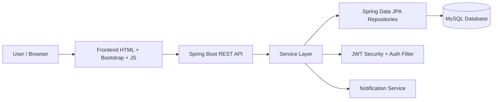
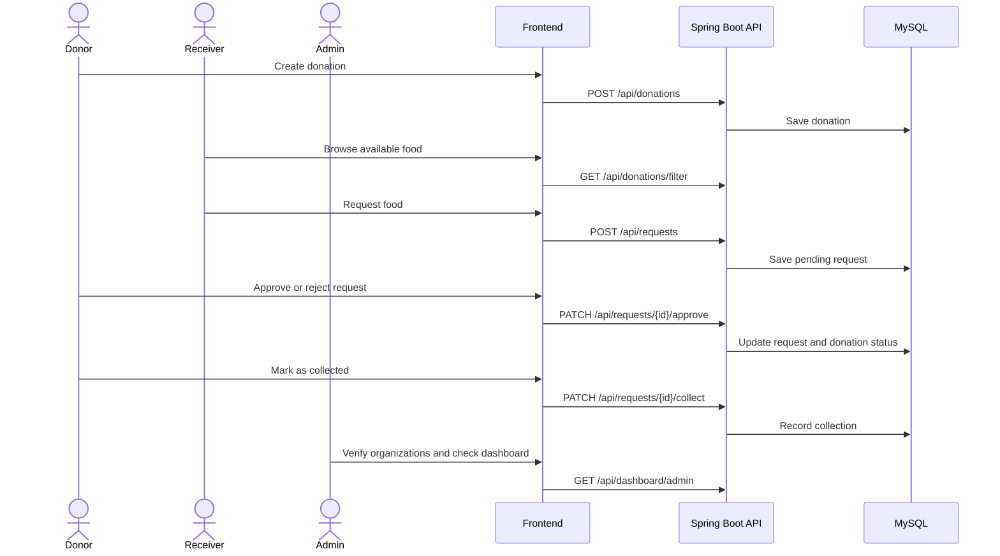
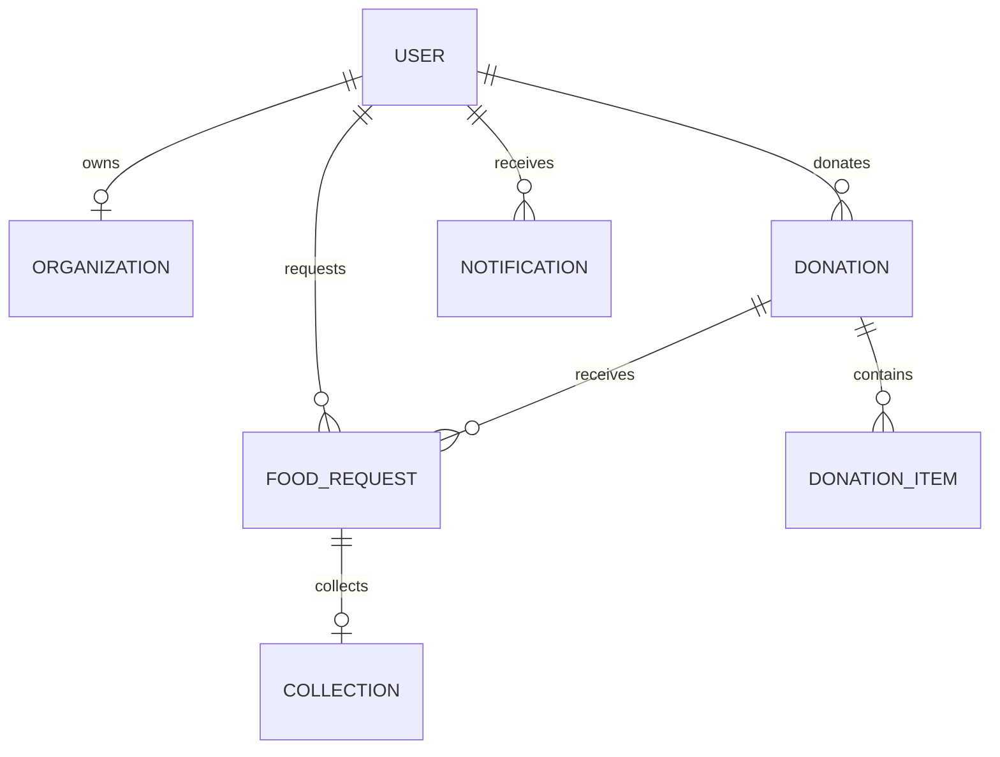
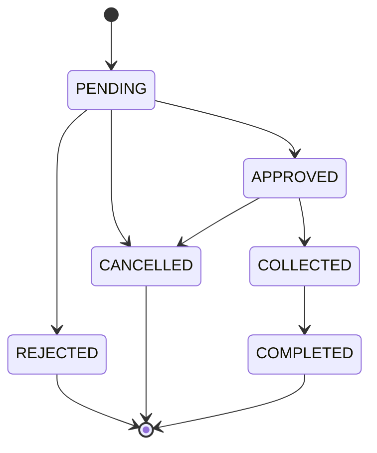

# FoodBridge

FoodBridge is a full-stack food donation and redistribution platform that connects donors, verified receiver organizations, and administrators. It helps restaurants, hotels, canteens, and other food providers donate surplus food to verified NGOs and charitable organizations before it expires.

The project is built with Java 17, Spring Boot 3, MySQL, and a static HTML/CSS/JavaScript frontend. The backend exposes a JWT-protected REST API, while the frontend uses fetch requests to render role-based dashboards and workflows.

## Overview

FoodBridge solves a practical coordination problem:

- Donors want to reduce food waste and distribute useful items quickly.
- Receivers need verified access to available food supplies.
- Admins must monitor and validate organizations safely.
- The system creates a structured workflow from donation to collection and completion.

## Features

- Role-based access for Admin, Donor, and Receiver users
- JWT authentication and BCrypt password hashing
- Donation creation, editing, cancellation, and status tracking
- Receiver-side food request submission and monitoring
- Donor approval/rejection flow for incoming food requests
- Quantity validation and expiry checks to prevent invalid operations
- Organization verification workflow for NGOs
- Notification support for request and donation events
- Dashboard analytics by user role
- Search and filter support for available food listings

## System Architecture



## Business Flow



## Role Model

| Role | Responsibilities |
|------|-----------------|
| ADMIN | Manage users, verify organizations, monitor requests, review dashboards and reports |
| DONOR | Create donations, review requests, approve or reject them, mark food as collected |
| RECEIVER | Register organization, request food, track requests and collection history |

## Project Structure

```text
FoodBridge/
├── README.md
├── run-local.sh
├── run-local.ps1
├── backend/
│   ├── pom.xml
│   └── src/
│       ├── main/
│       │   ├── java/com/foodbridge/
│       │   │   ├── config/
│       │   │   ├── controller/
│       │   │   ├── dto/
│       │   │   ├── entity/
│       │   │   ├── exception/
│       │   │   ├── repository/
│       │   │   ├── security/
│       │   │   ├── service/
│       │   │   └── FoodBridgeApplication.java
│       │   └── resources/
│       │       └── application.properties
├── frontend/
│   ├── index.html
│   ├── login.html
│   ├── register.html
│   ├── css/style.css
│   ├── js/api.js
│   ├── admin/
│   ├── donor/
│   └── receiver/
└── .gitignore
```

## Backend Structure

### 1. config
Contains application configuration and startup utilities.

- `DataInitializer.java` seeds demo users, organizations, donations, and requests when the database is empty.
- `ScheduledTasks.java` handles scheduled checks for expiry and background workflow maintenance.

### 2. controller
Contains the REST API layer used by the frontend.

- `AuthController` handles login, registration, and current-user retrieval.
- `DonationController` manages donation listing, creation, update, and cancellation.
- `RequestController` handles request creation, approval, rejection, collection, and completion.
- `OrganizationController` manages organization creation and admin verification.
- `DashboardController` provides role-specific dashboard statistics.

### 3. service
Contains business logic and validation rules.

- `AuthService` creates users and authenticates them.
- `DonationService` validates donation lifecycle actions and constrained quantities.
- `FoodRequestService` controls request creation, donor decision-making, and collection flow.
- `OrganizationService` manages organization verification and record updates.
- `DashboardService` aggregates data for dashboards.

### 4. repository
Spring Data repositories for database data access.

Examples:

- `UserRepository`
- `DonationRepository`
- `FoodRequestRepository`
- `OrganizationRepository`
- `NotificationRepository`

### 5. entity
JPA entity classes represent the database model.

Key entities include:

- `User`
- `Organization`
- `Donation`
- `DonationItem`
- `FoodRequest`
- `Collection`
- `Notification`

### 6. security
Contains JWT and Spring Security setup.

- `SecurityConfig` defines request authorization rules, CORS, and authentication providers.
- `JwtAuthenticationFilter` validates bearer tokens.
- `JwtService` creates and validates JWTs.
- `UserDetailsServiceImpl` loads user details for authentication.

### 7. dto
Data Transfer Objects keep API payloads separate from JPA entities.

### 8. exception
Custom exceptions and a global exception handler centralize errors.

## Frontend Structure

The frontend is a static app built with HTML, CSS, and JavaScript. It acts as a client layer for the backend through the centralized API client in `frontend/js/api.js`.

### Frontend pages

- `frontend/index.html` – landing page
- `frontend/login.html` – login form
- `frontend/register.html` – registration form
- `frontend/admin/` – admin dashboard and management views
- `frontend/donor/` – donor dashboard, donation forms, request management
- `frontend/receiver/` – food browsing, request pages, collection history

### Frontend client behavior

- Stores the JWT in `localStorage`
- Saves the logged-in user details in `localStorage`
- Redirects unauthorized users to login
- Enforces role-based UI access using helper functions

## Database Design

The project uses MySQL with JPA entities. The main relationships are:



### Main tables/entities

- `users` — user accounts, roles, and account status
- `organizations` — receiver organizations and verification status
- `donations` — donor-created food listings
- `donation_items` — item-level details inside a donation
- `requests` — requester/donor workflow state
- `collections` — pickup and confirmation records
- `notifications` — system activity updates

## Donation Lifecycle

The donation lifecycle is the central workflow:

1. A donor creates a donation with food details, quantity, preparation time, expiry time, and pickup address.
2. A receiver browses available donations and submits a request.
3. The donor approves or rejects the request.
4. Approved requests are tracked and donation status changes as the workflow moves forward.
5. The donor marks the food as collected.
6. The request is completed and reported in dashboards.

## Request Workflow



## Runtime Configuration

Backend configuration is stored in:

`backend/src/main/resources/application.properties`

Example contents:

```properties
server.port=8080
spring.datasource.url=jdbc:mysql://localhost:3306/foodbridge_db
spring.datasource.username=root
spring.datasource.driver-class-name=com.mysql.cj.jdbc.Driver
spring.jpa.hibernate.ddl-auto=update
app.jwt.secret=your-secret-key
app.jwt.expiration=86400000
```

Update the database URL and credentials before starting the application.

## Setup and Run

### Prerequisites

- Java 17+
- Maven 3.8+
- MySQL 8+
- Modern browser

### 1. Create the database

```sql
CREATE DATABASE foodbridge_db CHARACTER SET utf8mb4 COLLATE utf8mb4_unicode_ci;
```

### 2. Configure database credentials

Open `backend/src/main/resources/application.properties` and set your local MySQL username and password.

### 3. Start the backend

```bash
cd backend
mvn spring-boot:run
```

The API runs on:

```text
http://localhost:8080/api
```

### 4. Serve the frontend

From the project root or frontend folder, run a static server:

```bash
cd frontend
python -m http.server 5500
```

Open:

```text
http://localhost:5500
```

### 5. Use the helper scripts

The project includes launch scripts to simplify local development:

- `run-local.sh`
- `run-local.ps1`

These scripts check prerequisites and start both backend and frontend together.

## Demo Credentials

The app seeds demo accounts automatically when the database is empty.

| Role | Email | Password |
|------|-------|----------|
| Admin | admin@foodbridge.com | password123 |
| Donor | donor1@foodbridge.com | password123 |
| Donor | donor2@foodbridge.com | password123 |
| Receiver | receiver1@foodbridge.com | password123 |
| Receiver | receiver2@foodbridge.com | password123 |
| Pending Receiver | pending@foodbridge.com | password123 |

## API Highlights

### Authentication

- `POST /api/auth/register`
- `POST /api/auth/login`
- `GET /api/auth/me`

### Donations

- `GET /api/donations`
- `GET /api/donations/filter`
- `GET /api/donations/{id}`
- `POST /api/donations`
- `PUT /api/donations/{id}`
- `PATCH /api/donations/{id}/cancel`

### Requests

- `POST /api/requests`
- `GET /api/requests/my-requests`
- `PATCH /api/requests/{id}/approve`
- `PATCH /api/requests/{id}/reject`
- `PATCH /api/requests/{id}/collect`
- `PATCH /api/requests/{id}/complete`

### Organizations

- `GET /api/organizations`
- `POST /api/organizations`
- `PATCH /api/organizations/{id}/verify`

### Dashboard

- `GET /api/dashboard/admin`
- `GET /api/dashboard/donor`
- `GET /api/dashboard/receiver`

## Security Notes

The application uses Spring Security with JWT-based authentication and stateless session handling. The backend restricts access based on role and protects sensitive API endpoints.

Important security features include:

- BCrypt password hashing
- JWT bearer token validation
- CORS configuration for local frontend origins
- `@PreAuthorize` based role enforcement

## Why This Project Works Well

This project is a good example of a real-world full-stack application because it combines:

- backend domain logic and validation
- relational persistence with JPA and MySQL
- identity and authorization with Spring Security
- role-based front-end workflows
- operational business rules such as donations, requests, and expiry checks

## Future Improvements

Possible production improvements include:

- email verification and password reset
- image upload for donations
- push notifications and SMS alerts
- logistics and route planning integration
- deeper analytics and reporting
- stronger audit trails and administrative controls

## Conclusion

FoodBridge is a complete donation coordination platform connecting food donors and verified receivers. Its layered architecture, Spring-based backend, static frontend, and relational database model make it understandable, extendable, and suitable for local or hosted deployment.

To run it locally, configure MySQL, start the backend with Maven, serve the frontend, and log in using the seeded demo accounts.
